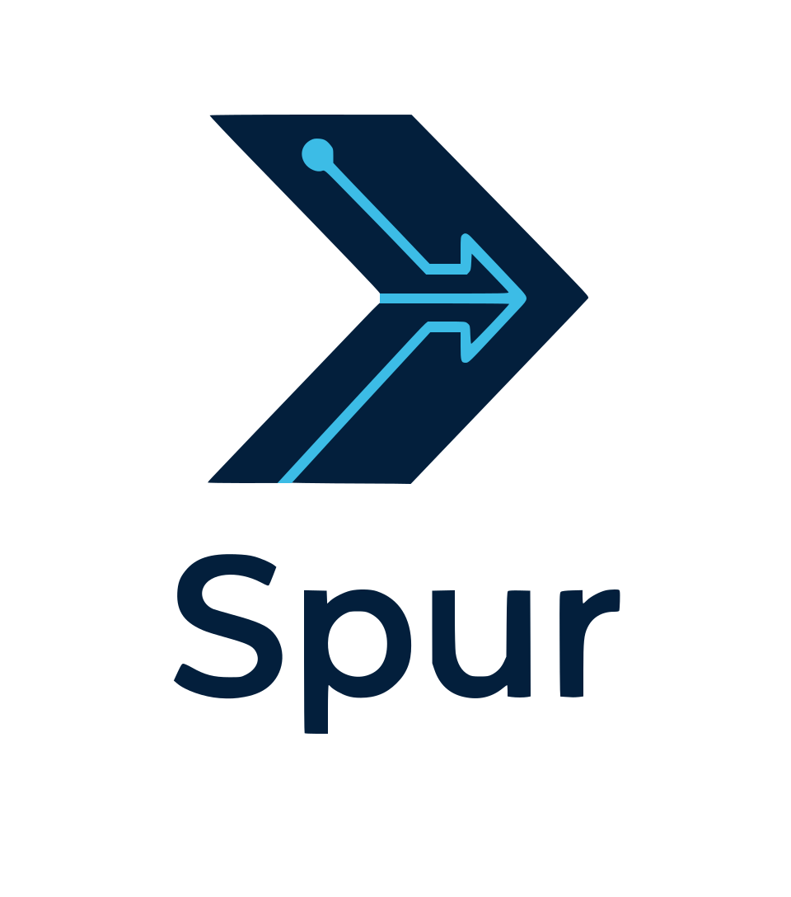

# Spur

<div align="center">
  
</div>

**Local-first harness engineering toolkit for mainstream coding agents.**

Spur is **not** a coding agent and **not** a BYOK LLM platform. It assumes you already have coding
agents installed and authenticated (Claude Code, Codex, Gemini CLI, pi, omp, OpenCode, Antigravity,
OpenClaw, Hermes, Grok), then wraps them with execution discipline: agent detection and health
checks, constraint checking, workflow orchestration, conversation-history import and analytics, and

- **Marketplace entry:** `name: "sp"`, `version: "0.3.41"`, `source: "./plugins/sp"` (`plugin.json`,

---

## What Spur Does

```text
idea → agent detection + health → constraint checking → workflow orchestration
  → agent execution → history import + analytics → inspection → repeat
```

- **Rule Engine** — YAML-driven constraint checking backed by [`@gobing-ai/ts-rule-engine`][rule].
  Evaluators (regex, AST via ast-grep, path, TSDoc, forbidden-import, secrets, coverage gate),
  composable presets (`recommended`, `recommended-post-check`), and auto-fixers. `--verbose` streams per-rule
  progress with execution time (e.g. `✓ passed - 0.12s`). Bundled presets ship with the engine,
  so `spur rule run` works on a clean install.
- **Workflow Engine** — FSM state-machine and transition-flow workflows backed by
  [`@gobing-ai/ts-dual-workflow-engine`][wf]. Define multi-step processes (implement → check → fix
  loops) as YAML with guards, gates, and bounded iteration.
- **Agent Runner** — Detect, invoke, and health-check installed coding agents through a unified
  interface backed by [`@gobing-ai/ts-ai-runner`][ai]. Spur never stores agent keys — agents
  authenticate with their own credentials.
- **History Analytics** — Import agent conversation JSONL and derive token/cost analytics via
  [`@gobing-ai/ts-llm-jsonl-importer`][hist]. Raw data stays in files; only validated, redacted ETL
  rows are persisted.
- **CLI** — Single `spur` binary for every operation.
- **Server / Web** — Hono on Bun (or Cloudflare Workers) exposing an oRPC OpenAPI handler, plus an
  Astro dashboard consuming the typed oRPC client.
- **Desktop** — optional Electron shell (`bun run desktop:dev`) that spawns that local server and opens `/board`. See [`apps/desktop/README.md`](apps/desktop/README.md).

---

## Install

Get the `spur` harness tool. Two paths, depending on whether you run Bun. Both expose a global
`spur` command and seed defaults into `~/.config/spur/` on first run.

**With Bun (`>= 1.3.0`) — recommended:**

```bash
# go with bun, suggested
bun add -g @gobing-ai/superskill @gobing-ai/spur

# or, run ad-hoc, no install:
bunx @gobing-ai/spur --help

# or, go with npm
npm i -g @gobing-ai/superskill @gobing-ai/spur
```

As we also need `@gobing-ai/superskill` to installed `sp` plugin, so I also installed it. The npm package also ships the `sp` plugin and its marketplace manifest. Install the plugin into your supported coding agents without cloning this repo:

```bash
# go with owner/repo shorthand → GitHub
superskill install sp --marketplace gobing-ai/spur
# or, go with the full path of the github URL
superskill install sp --marketplace https://github.com/gobing-ai/spur
# or, go with pre-installed via bun
superskill install sp --marketplace $(dirname $(bun pm bin -g))/install/global/node_modules/@gobing-ai/spur
# or, go with pre-installed via npm
superskill install sp --marketplace $(dirname $(npm root -g))/node_modules/@gobing-ai/spur
# or, go with already downloaded source code
superskill install sp --marketplace /Users/robin/xprojects/spur-new
```

**Without Bun — standalone binary (macOS / Linux):**

```bash
curl -fsSL https://raw.githubusercontent.com/gobing-ai/spur/main/scripts/install.sh | sh
```

Installs to `~/.local/bin` (override via `SPUR_INSTALL`), embeds the Bun runtime, and runs
`spur init` for you. The binary is verified against the release `SHA256SUMS` before install — and
because the installer then *runs* that binary, the checksum is a code-execution boundary, not just
an integrity check; keep the `SPUR_SKIP_VERIFY=1` bypass exceptional. Full options, verification and
Windows/WSL notes live in the [CLI README](./apps/cli/README.md#install).

```bash
spur --help
spur init       # seed ~/.config/spur/ — idempotent
```

---

## Quick Start

> For **developing Spur itself** (running from source). To just _use_ the tool, see
> [Install](#install) above.

```bash
# Prerequisites: Bun 1.4.3 (pinned in .prototools)
bun install

# Run the CLI from source (the .ts entry runs only under Bun)
bun run apps/cli/src/index.ts --help

# Scaffold a project: writes .spur/config.yaml, local rules + an example
# workflow, and seeds ~/.config/spur/rules from the bundled presets
bun run apps/cli/src/index.ts init --name my-project

# Evaluate constraint rules over the working tree
bun run apps/cli/src/index.ts rule run --preset recommended

# Run the full quality gate (lint + typecheck + tests)
bun run check
```

> During development the CLI runs as `bun run apps/cli/src/index.ts <command>`. A standalone `spur`
> binary is produced by `bun run build`.

---

## Monorepo Structure

Bun workspaces (no Turborepo). Generic engines live **outside** this repo as released
`@gobing-ai/ts-*` packages, consumed by semver; Spur is a domain consumer.

```
apps/
  cli/          Spur CLI — primary surface; arg dispatch + domain commands   (@gobing-ai/spur)
  server/       Hono on Bun.serve / Cloudflare Worker; oRPC OpenAPI handler  (@gobing-ai/spur-server)
  web/          Astro + Cloudflare adapter; typed oRPC OpenAPI client        (@gobing-ai/spur-web)
packages/
  app/          Application services (AgentService, RuleService, WorkflowService, …) (@gobing-ai/spur-app)
  contracts/    oRPC transport contracts only — health/DTOs, no domain types          (@gobing-ai/spur-contracts)
  config/       Zod config schema + env parsing                                       (@gobing-ai/spur-config)
  domain/       Spur-domain DAOs + schema (workspaces, runs, artifacts, …)            (@gobing-ai/spur-domain)
tooling/
  typescript/   Shared tsconfig presets (base/server/react)
drizzle/        0000_spur_cli_foundation.sql (active) + _legacy_reference/ (inert)
docs/           00_ADR.md (authoritative) + 01–05 product docs
```

**Boundaries:** `contracts` owns transport DTOs only — domain types belong in their owning
`@gobing-ai/ts-*` package. The server binds handlers via `implement(contract)` so contract↔handler
drift fails at compile time; OpenAPI is generated from the contract. Web consumes only contract types
via the oRPC client and never reaches into server internals.

---

## Domain Engines (external `@gobing-ai/ts-*`)

Consumed from the separate [`ts-libs`](https://github.com/gobing-ai/ts-libs) repository by semver,
centralized in the root Bun catalog.

| Package                                    | Role                                                               |
| ------------------------------------------ | ------------------------------------------------------------------ |
| [`@gobing-ai/ts-utils`][utils]             | output, errors, api-response, cursor, date, access helpers         |
| [`@gobing-ai/ts-infra`][infra]             | logger, EventBus, telemetry, scheduler, job-queue interfaces       |
| [`@gobing-ai/ts-runtime`][runtime]         | runtime context, FileSystem, ProcessExecutor, config loader        |
| [`@gobing-ai/ts-db`][db]                   | DbAdapter, BaseDao, migrations, QueueJobDao                        |
| [`@gobing-ai/ts-ai-runner`][ai]            | `AgentDetector`, `DoctorRunner`, `AiRunner` (backs `spur agent`)   |
| [`@gobing-ai/ts-rule-engine`][rule]        | `RuleEngine`, evaluators, presets, formatters (backs `spur rule`)  |
| [`@gobing-ai/ts-dual-workflow-engine`][wf] | FSM + transition-flow engine (backs `spur workflow`)               |
| [`@gobing-ai/ts-llm-jsonl-importer`][hist] | `runJsonlImport`, SourceDefinition pipeline (backs `spur history`) |

---

## CLI Surface

Every command supports `--json` for machine consumption.

```
spur init       [--name <name>] [--force] [--minimal] [--json]
spur agent      run <prompt> [--agent <name>] [--continue] [--model <name>] [--mode <mode>] [--cwd <path>] [--json]
spur agent      list [--json]
spur agent      doctor [agent] [--json]
spur rule       run [--preset <name>] [--file <path>] [--rule <id>] [--fail-on <severity>] [--verbose] [--json]
spur rule       validate [--file <path>|--preset <name>|<path>] [--json]
spur rule       list [--preset <name>] [--json]
spur workflow   validate <workflow.yaml> [--json]
spur workflow   run <workflow.yaml> [--run-id <id>] [--json]
spur workflow   list [--json]
spur history    import --source <source> [--file <path>|--root <path>] [--mode <mode>] [--json]
spur history    analyze [--since <iso-date>] [--json]
spur history    report [--json]   # reserved; prints a TODO marker for now
spur status     [path] [--json]
spur migrate    [--json]          # temporary helper: apply CLI-owned schema migrations
```

`init`, `agent`, `history`, `rule`, `workflow` are the committed product surface; `status` and
`migrate` are supporting utilities. See [`docs/04_DESIGN.md`](docs/04_DESIGN.md) for flag-level
detail.

---

## Tech Stack

| Layer                                   | Technology                                                                   |
| --------------------------------------- | ---------------------------------------------------------------------------- |
| Runtime / package manager / test runner | [Bun](https://bun.sh/) `1.4.3` (prefer `bun:*` over `node:*`)               |
| Language                                | TypeScript (strict)                                                          |
| Lint + format                           | [Biome](https://biomejs.dev/) `2.5.15` (no ESLint, no Prettier)              |
| Type seam                               | [oRPC](https://orpc.unnoq.com/) `1.14.x` (contract-first, OpenAPI generated) |
| HTTP                                    | [Hono](https://hono.dev/) on `Bun.serve` / Cloudflare Workers                |
| Web                                     | [Astro](https://astro.build/) + Cloudflare adapter                           |
| DB                                      | SQLite via `@gobing-ai/ts-db`                                                |
| Validation                              | [Zod](https://zod.dev/) 4                                                    |
| Tool versions                           | pinned in `.prototools` ([proto](https://moonrepo.dev/proto))                |
| Hooks                                   | [Lefthook](https://github.com/evilmartians/lefthook)                         |
| Deploy                                  | Cloudflare Workers (server), Cloudflare (web)                                |

---

## External Dependencies

Everything Spur installs, runs, or talks to that is **not** defined in this repository. Versions
are centralized: any package shared across ≥2 workspaces lives once in the root `package.json`
`workspaces.catalog` and is referenced as `"catalog:"`; CLI toolchain versions are pinned in
`.prototools` (proto). The private domain engines live outside this repo — their roles are in the
**Domain Engines** table above.

**How to read `Confidence`** — it grades this inventory, not the dependency: **HIGH** = the version
comes from the authoritative in-repo pin *and* the role is confirmed by a call site or an executed
command; **MEDIUM** = the pin is confirmed but the role is inferred (peer metadata, config only) or
the local install differs from the pin; **LOW** = neither a pin nor a probe backs the claim here.

### Runtime prerequisites

Installed and authenticated by the operator. Spur never stores agent or provider keys.

| Dependency                                                                                              | Version                                   | Needed for                                                                                 | Confidence | Verified by                                                                                            |
| ------------------------------------------------------------------------------------------------------- | ----------------------------------------- | ------------------------------------------------------------------------------------------ | ---------- | ------------------------------------------------------------------------------------------------------ |
| [Bun](https://bun.sh/)                                                                                  | `1.4.3` (`packageManager`, `.prototools`) | Runtime, package manager, test runner and bundler; the standalone binary embeds it          | HIGH       | `bun -v` → `1.4.3` on this machine                                                                       |
| [Node.js](https://nodejs.org/)                                                                          | `24.21.0` (`.prototools`)                 | Vite/Astro and `@cloudflare/vitest-pool-workers` tooling; Electron brings its own runtime   | MEDIUM     | pin read; the local install is `node` 24.13.0, not the pinned 24.21.0                                   |
| [Git](https://git-scm.com/)                                                                             | any recent                                | Every repository-backed command (`status`, `task record`, `builder`, pipelines)             | HIGH       | `git --version` → 2.55.0; exercised throughout this session                                             |
| [GitHub CLI](https://cli.github.com/) `gh`                                                              | authenticated                             | `spur builder pr`, branch and release operations                                            | MEDIUM     | `gh` 2.102.0 present; only `builder pr` / release code paths call it, and those were not exercised      |
| Coding agents (Claude Code, Codex, Gemini CLI, pi, omp, OpenCode, Antigravity, OpenClaw, Hermes, Grok)   | detected at runtime                       | `spur agent` detection, health checks and execution — `spur agent doctor` reports usability | HIGH       | `spur agent doctor --json`: claude 2.1.304, codex-cli 0.163.0, Antigravity 1.4.2, pi 0.87.1 all usable |

### Optional backends and services

| Backend                                                                                    | Requirement                                                       | Enables                                                                                     | Confidence | Verified by                                                                                          |
| ------------------------------------------------------------------------------------------ | ----------------------------------------------------------------- | ------------------------------------------------------------------------------------------- | ---------- | ---------------------------------------------------------------------------------------------------- |
| [proto](https://moonrepo.dev/proto)                                                        | optional                                                          | Installs the `.prototools` pins (`bun`, `node`, `biome`, `lefthook`, `cog`, `act`, `actionlint`) | MEDIUM     | `proto --version` → 0.62.2; the pins were not installed through it on this machine                    |
| Typesafe (hosted)                                                                          | `TYPESAFE_API_KEY`                                                | `typesafe` decision maker — hosted classification (`@typesafe-ai/sdk`)                      | LOW        | the key is read by `status` and the Typesafe driver; unset here, so no decision was ever served by it |
| Cloudflare Workers AI (hosted)                                                             | `CLOUDFLARE_ACCOUNT_ID` + `CLOUDFLARE_AUTH_TOKEN`                 | `clef` decision maker (`@gobing-ai/ts-decision-clef`); unset → the maker is not registered  | MEDIUM     | env names read from the credential function (`packages/app/src/decision/decision-service.ts:673`); creds unset here |
| Laya / MLX (local)                                                                         | macOS + a Python with MLX                                         | `laya-local` decision maker (`@gobing-ai/ts-laya-mlx`) — model runs locally, no API key     | MEDIUM     | `python3` has MLX 0.32.0; the `laya-local` worker was not started here                               |
| OTLP collector                                                                             | `SPUR_TELEMETRY_ENABLED` + endpoint                               | OpenTelemetry traces and metrics through the `@opentelemetry/*` exporters                   | LOW        | exporter pins only; no endpoint is configured and no span was exported                               |
| Cloudflare Workers                                                                         | `wrangler` (dev dependency) + a Cloudflare account                | Deploying `apps/server` and the `apps/web` board; `bun run test-cf` for the Workers runtime | MEDIUM     | `wrangler` 4.95.0 declared with `apps/server/vitest.cf.config.ts`; `bun run test-cf` not run          |
| [Lefthook](https://github.com/evilmartians/lefthook) + [cog](https://crates.io/crates/cog)  | `lefthook` via `bun install` (`prepare`); `cog` via proto         | Git hooks: format on `pre-commit`, Conventional Commits on `commit-msg`                     | HIGH       | both ran on this repo's commits: `lefthook 2.2.2` on `pre-commit`, `cog 7.0.0` on `commit-msg`        |
| [act](https://github.com/nektos/act) + [actionlint](https://github.com/rhysd/actionlint)   | `.prototools`                                                     | `bun run verify-gha-ci` — local CI simulation                                               | LOW        | `act` 0.2.89 works; the `actionlint` pin does not resolve (proto plugin URL returns 404)              |

### Third-party packages (installed by `bun install`)

| Where                            | Package                                                                                         | Version   | Role                                                          | Confidence | Verified by                                                                        |
| -------------------------------- | ----------------------------------------------------------------------------------------------- | --------- | ------------------------------------------------------------- | ---------- | ---------------------------------------------------------------------------------- |
| root (dev)                       | `@biomejs/biome`                                                                                | `2.5.15`  | Lint + format (the only linter/formatter)                     | HIGH       | `bunx biome check .` ran here over 1585 files                                      |
| root (dev)                       | `typescript`                                                                                    | `6.0.3`   | `tsc --noEmit` per workspace                                  | HIGH       | `bun run typecheck` ran here                                                       |
| root (dev)                       | `lefthook`                                                                                      | `2.2.2`   | Git hook runner                                               | HIGH       | `lefthook --version` → 2.2.2; hooks executed on this repo's commits                |
| root (dev)                       | `@gobing-ai/superskill`                                                                         | `0.3.39`  | Installs the `sp` plugin into each coding agent               | MEDIUM     | pinned and installed; not executed in this session                                 |
| root (dev)                       | `@earendil-works/pi-coding-agent`                                                               | `0.87.1`  | pi host SDK                                                   | LOW        | pin only — no reference outside `package.json`                                     |
| root (dev)                       | `@logtape/logtape`                                                                              | `2.1.1`   | Structured logging behind `ts-infra`                          | MEDIUM     | dependency of `ts-infra`; no direct import here                                    |
| root (dev)                       | `@opentelemetry/api`, `sdk-trace-node`, `sdk-metrics`, `resources`, `semantic-conventions`, `exporter-{trace,metrics}-otlp-http` | `1.9.1` / `2.7.1` / `0.218.0` | Telemetry pipeline (peer requirements of `ts-infra`)          | MEDIUM     | peers declared by `ts-infra`; nothing imports them directly here                   |
| root (dev)                       | `drizzle-zod`                                                                                   | `0.8.3`   | Schema helpers for the `drizzle-orm` peer of `ts-db`          | MEDIUM     | peer of `ts-db`; no direct import here                                             |
| `apps/cli`                       | `commander` + `@commander-js/extra-typings`                                                     | `^14.0.3` | Command parsing                                               | HIGH       | imported in `apps/cli/src/index.ts`                                                |
| `apps/cli`                       | `@clack/prompts`                                                                                | `1.5.1`   | Interactive HITL prompts (`hitl.confirm` / `hitl.select`)     | HIGH       | `apps/cli/src/workflow/hitl/clack-responder.ts`                                    |
| `apps/cli`                       | `node-notifier`                                                                                 | `10.0.1`  | Desktop notifications for HITL waits                          | HIGH       | `apps/cli/src/workflow/hitl/desktop-notify.ts`                                     |
| `apps/cli`                       | `figlet`                                                                                        | `^1.11.0` | Startup banner                                                | HIGH       | `apps/cli/src/index.ts`                                                            |
| `apps/server`                    | `hono`                                                                                          | `4.12.23` | HTTP routing on `Bun.serve` / Cloudflare Workers              | HIGH       | routing code + a clean `apps/server` typecheck                                     |
| `apps/server`                    | `@orpc/server`, `@orpc/openapi`, `@orpc/zod`                                                    | `1.14.4`  | Contract-first RPC handler + generated OpenAPI               | HIGH       | `implement(contract)` handlers and the generated OpenAPI document                  |
| `apps/server` (dev)              | `wrangler`, `@cloudflare/vitest-pool-workers`, `vitest`, `vite`, `@hono/vite-{build,dev-server}` | `4.95.0` / `0.22.0` / `4.1.7` / `7.3.3` | Workers dev server, deploy and `bun run test-cf`  | MEDIUM     | declared with `vitest.cf.config.ts`; `bun run test-cf` not run                     |
| `apps/web`                       | `astro`, `@astrojs/react`                                                                       | `6.4.2` / `5.0.7` | Static board shell + React islands                     | HIGH       | `apps/web/astro.config.mjs` + a clean `apps/web` typecheck                          |
| `apps/web`                       | `react`, `react-dom`, `react-router`                                                            | `19.2.1` / `7.11.0` | Board UI and routing                                | HIGH       | board components and route modules + web typecheck                                 |
| `apps/web`                       | `tailwindcss`, `daisyui` (dev: `@tailwindcss/vite`)                                             | `4.3.2` / `5.0.29` | Styling (`DESIGN.md` owns the visual language)              | HIGH       | imported by `apps/web/src/styles/global.css`                                       |
| `apps/web`                       | `@dnd-kit/core`, `@dnd-kit/utilities`                                                           | `6.3.1` / `3.2.2` | Kanban drag-and-drop                                  | HIGH       | `TaskCard.tsx` / `KanbanColumn.tsx` / `KanbanBoard.tsx`                            |
| `apps/web`                       | `lucide-react`                                                                                  | `1.52.0`  | Icons                                                         | HIGH       | `status-icons.tsx`, `ThemeToggle.tsx`, `ModuleIcon.tsx`                            |
| `apps/web`                       | `mermaid`                                                                                       | `11.15.0` | Diagram rendering (dynamically imported)                      | MEDIUM     | dynamic import in `MarkdownBody.tsx`; `branch-topology-graph.heavy.test.ts` not run |
| `apps/web`                       | `@uiw/react-md-editor`                                                                          | `4.1.1`   | Markdown editor                                               | HIGH       | imported in `apps/web/src/ui.ts`                                                   |
| `apps/web`                       | `dompurify`, `hast-util-from-html`, `hast-util-to-html`                                          | `3.4.11` / `2.0.3` / `9.0.5` | Sanitized Markdown → HTML render path     | HIGH       | `apps/web/src/lib/markdown-safety.ts`                                              |
| `apps/web`                       | `@orpc/client`, `@orpc/contract`, `@orpc/openapi-client`, `@orpc/shared`                        | `1.14.4`  | Typed client over the generated OpenAPI contract              | HIGH       | `apps/web/src/lib/rpc-client.ts`                                                   |
| `apps/web` (dev)                 | `happy-dom`, `@happy-dom/global-registrator`, `@testing-library/{dom,react}`, `vite`            | `20.10.4` / `10.4.1` / `16.3.2` / `7.3.3` | DOM integration tests                 | MEDIUM     | harness files exist under `apps/web/tests`; `bun run test` not run                 |
| `apps/desktop` (dev)             | `electron`, `electron-builder`                                                                  | `44.5.1` / `26.15.3` | Desktop shell that attaches to the project server     | MEDIUM     | declared with `electron-builder.yml`; `bun run desktop:smoke` not run              |
| `packages/*`                     | `zod`                                                                                           | `4.4.3`   | Config, contract and payload validation                       | HIGH       | schemas across `packages/*` + typecheck                                            |
| `packages/*`                     | `yaml`                                                                                          | `2.9.0`   | Catalog, workflow and rules parsing                          | HIGH       | `apps/cli/src/config.ts` and the catalog loaders                                    |
| `packages/app`                   | `@gobing-ai/ts-ai-decision`, `@gobing-ai/ts-decision-clef`, `@gobing-ai/ts-laya-mlx`            | `0.5.32`  | Decision catalog hub + the hosted and local makers            | HIGH       | imported in `packages/app/src/decision/decision-service.ts`                        |

Notable transitive packages that are part of the runtime contract: `drizzle-orm` `0.44.7` (peer of
`ts-db`), `@typesafe-ai/sdk` `0.7.0` (Typesafe driver) and `@johnhenry/laya` `0.3.2` (MLX process
bridge). Private `@gobing-ai/ts-*` engines are consumed by semver (`^0.5.32`) from
[`ts-libs`](https://github.com/gobing-ai/ts-libs); `@gobing-ai/spur-*` are workspace packages, not
published dependencies of the CLI.

---

## Commands

```bash
bun run dev          # bun run --filter '*' dev — all workspaces
bun run lint         # biome check + per-workspace tsc --noEmit  (the gate)
bun run format       # biome check --write                       (autofix)
bun run test         # bun test --coverage --coverage-dir=.coverage (all workspaces)
bun run test-cf      # Cloudflare Workers Vitest (server)
bun run check        # lint + test (local gate)
bun run build        # clean, then build cli/server/web into root dist/
bun run clean        # reset root dist/

# Dogfood gate — runs Spur's own rule engine via the source CLI
bun run spur-check   # lint + rule pre-check + test + rule post-check
```

### Verification gate (all must pass before "done")

1. `bun run lint` — Biome + per-workspace `tsc --noEmit`.
2. `bun run test` — no test skipped, `.skip`'d, or commented out to go green.
3. `bun run test-cf` — server Workers runtime.
4. `bun run build` — succeeds across all workspaces.
5. `git status` — only intentional changes.

Never bypass with `--no-verify`, `--force`, or new `biome-ignore` suppressions added solely to
silence the gate.

---

## Configuration

`spur init` writes a single `.spur/config.yaml` (ADR-027; the legacy `.spur/config.json`
project marker is retired). It carries a portable `bootstrap:` block (logging, telemetry,
database, scheduler — consumed by `@gobing-ai/ts-infra`) plus a Spur app section (`agent`,
`rules`, `workflows`, `tasks`) validated by `spurConfigSchema`. Resolution order: project
`.spur/config.yaml` → fallback `~/.config/spur/config.yaml`.

App-layer config (server/web) comes from `@gobing-ai/spur-config` (`buildConfigFromEnv`): `DATABASE_URL`,
`PORT`, `SPUR_TELEMETRY_ENABLED`, `SPUR_LOG_LEVEL`, etc. Spur never stores agent API keys — auth is
the agent's concern.

Rule roots resolve highest-priority-first: `SPUR_RULES_PATH` → local `.spur/rules` →
`~/.config/spur/rules` → presets bundled with `ts-rule-engine`. A `rule run` that resolves zero rules
exits non-zero (a gate that checks nothing is not a pass).

---

## Documentation

Read the doc that governs your change before editing code. On conflict, **lower number wins**
(`00_ADR` is binding and overrides all others).

| Document                                             | Purpose                                                      | Authority                          |
| ---------------------------------------------------- | ------------------------------------------------------------ | ---------------------------------- |
| [`docs/00_ADR.md`](docs/00_ADR.md)                   | _Why_ — binding architecture decisions                       | Authoritative (wins all conflicts) |
| [`docs/01_PRD.md`](docs/01_PRD.md)                   | _What_ — product, scope, in/out of scope                     | Authoritative for scope            |
| [`docs/02_ROADMAP.md`](docs/02_ROADMAP.md)           | _When_ — phases, current vs deferred work                    | Derived                            |
| [`docs/03_ARCHITECTURE.md`](docs/03_ARCHITECTURE.md) | _How_ — module boundaries, data flow, invariants             | Derived (ADR wins)                 |
| [`docs/04_DESIGN.md`](docs/04_DESIGN.md)             | Concrete non-UI surface — CLI commands, config schemas, DTOs | Derived                            |
| [`DESIGN.md`](DESIGN.md)                             | UI/UX design SSOT — visual language, tokens, component specs | Authoritative for UI/UX (dynamic)  |
| [`docs/05_FEATURES.md`](docs/05_FEATURES.md)         | Feature decomposition + status (✅/🔶/⏳/💤)                 | Derived                            |

Agent-facing guidance for working in this repo lives in [`AGENTS.md`](AGENTS.md) (`CLAUDE.md` /
`GEMINI.md` symlink to it).

---

## Conventions

- **Bun + TypeScript + Biome** monorepo on Bun workspaces. Never introduce a new runtime, package
  manager, linter, formatter, or Turborepo.
- **Version SSOT — Bun catalog.** Every dependency shared across ≥2 workspaces (the `@gobing-ai/ts-*`
  family, `@orpc/*`, `typescript`, `@types/bun`, `zod`) is declared once in the root `package.json`
  `workspaces.catalog` and referenced as `"catalog:"`. Package-private deps stay as literals.
- **Code style** (enforced by `biome.json`): 4-space indent, `lineWidth` 120, single quotes,
  semicolons, trailing commas. `interface` for object shapes, `type` for unions. `any` is an error.
- **Workspace imports** use the `@gobing-ai/*` alias, never deep relative paths into a sibling package.
- **Tests** live in `tests/` next to the code (`<workspace>/tests/**/*.test.ts`), using `bun:test`.
  Coverage target: line ≥ 85% and function ≥ 90% in aggregate.
- **Conventional Commits** required. A change touching a command/config/schema must keep
  `docs/04_DESIGN.md` in sync in the same commit.
- `vendors/` and `drizzle/_legacy_reference/` are reference-only — never modify.

---

## License

Apache-2.0 © [Robin Min](mailto:minlongbing@gmail.com)

<!-- ts-* package links -->

[utils]: https://github.com/gobing-ai/ts-libs/tree/main/packages/utils
[infra]: https://github.com/gobing-ai/ts-libs/tree/main/packages/infra
[runtime]: https://github.com/gobing-ai/ts-libs/tree/main/packages/runtime
[db]: https://github.com/gobing-ai/ts-libs/tree/main/packages/db
[ai]: https://github.com/gobing-ai/ts-libs/tree/main/packages/ai-runner
[rule]: https://github.com/gobing-ai/ts-libs/tree/main/packages/rule-engine
[wf]: https://github.com/gobing-ai/ts-libs/tree/main/packages/dual-workflow-engine
[hist]: https://github.com/gobing-ai/ts-libs/tree/main/packages/llm-jsonl-importer

## References

- [codex-usage-tracker](https://github.com/douglasmonsky/codex-usage-tracker)
- [superset](https://github.com/superset-sh/superset)
- [antigravity plugin](https://antigravity.google/docs/cli/plugins)
- [claude code plugin](https://code.claude.com/docs/en/plugins)
- [codex plugin](https://learn.chatgpt.com/docs/build-plugins)
- [omp plugin](https://omp.sh/docs/plugins)
- [grok plugin](https://docs.x.ai/build/features/skills-plugins-marketplaces#claude-code-compatibility)
