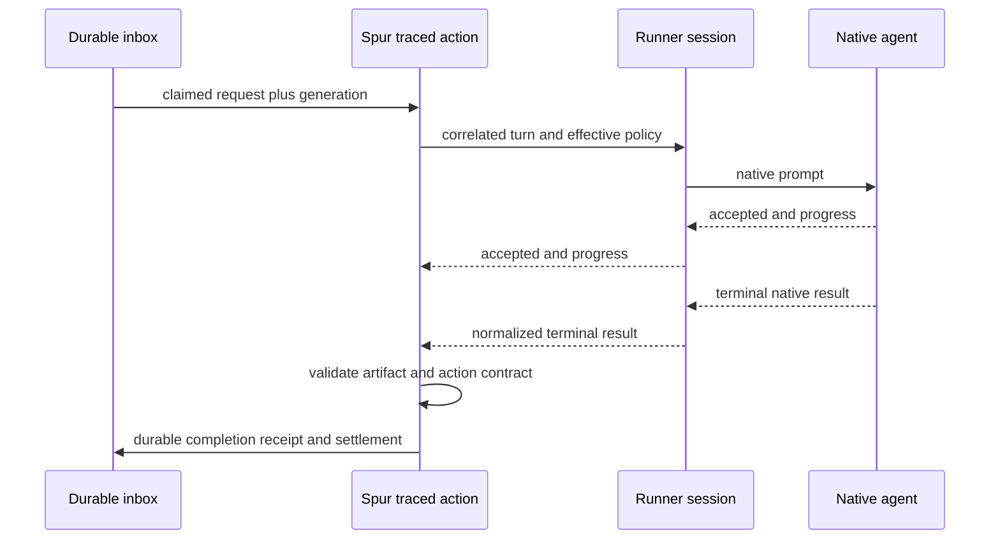

# Fleet task turns and measured warm execution

## 1. Issue and scope

G74 selects A2: keep deterministic scheduling responsive and run keyed tasks in warm Codex, Claude
Code and Pi processes without losing completion evidence. G75 consumes the same turn contract.
Related session and coordination behavior is documented by
[session-pinned dispatch](session-pinned-dispatch.md) and
[inter-agent control](inter-agent-control-plane.md).
The [measurement contract](../plans/2026-10-21-fleet-performance-measurement.md) owns KPI definitions,
trial controls and provisional performance targets.

Keyed requests retain the traced run/action contract and may reuse a qualified correlated worker.
The orchestrator conversation has separate in-flight state from its serialized scheduling tick.
Sending input establishes acceptance only; native terminal evidence and artifact validation are
separate completion boundaries.

## 2. Ownership and boundaries

- The existing workflow engine owns lifecycle transitions and action contract validation.
- `AgentRunActionRunner`, `runFleetWorkItem` and `AgentRunExecutor` retain result/artifact,
  execution-record, permission, routing and lineage responsibilities.
- ts-ai-runner owns reusable native process/protocol lifecycle and terminal-event normalization.
  No source copy, generic protocol workaround or value import from another repository enters Spur.
- `MemberSession` manages loop-lifetime reuse eligibility, reset and resume observations.
- The durable inbox remains the sole coordination transport. Native stdio is the final executor
  adapter, not a second agent-to-agent message plane.
- One scheduling owner, one active task turn per worker and one writer per worktree remain invariant.

## 3. Scheduling and execution flow

The orchestrator independently runs a serialized wake/reconcile/select/enqueue loop. Its conversation
consumer has separate in-flight state and uses the same inbox/ledger accounting. It cannot retain a
scheduler mutex while awaiting a model response. Coalesce wakes and rerun selection after the current
tick; do not launch concurrent ticks or lose arrivals during long chat. Preserve rest behavior,
owner renewal, strategy epochs and bounded shutdown of both consumers.

Keyed work remains claimed once and follows the shared traced boundary:

Transport acceptance and message delivery stay distinct from task success. Existing work-item
receipts remain the stage completion shape; normalized native events are input evidence, not a
replacement workflow or an independent success authority.

## 4. Released runner-facing contract

The released `AiRunner.openTurnSession` facade supplies this lifecycle. Spur consumes the facade
and its qualified driver registry; it does not implement the native transports.

| Operation | Required behavior |
| --- | --- |
| Open | fix effective executable/version, model/provider/reasoning, workspace, tools, permission policy and supported session features |
| Start one turn | accept execution/request/attempt/occupant-generation identity and prompt; return native session/thread/turn linkage when observable |
| Observe | stream bounded progress, output, usage and terminal result; correlate every event to the active turn |
| Cancel | request native interruption, await evidence of terminal state, and report unknown if completion cannot be established |
| Close/reset | stop a supervised process through existing runtime policy; detach a human-owned session without killing it |

Spur pins run ID, execution ID, action/state, request/message ID, attempt, member ID, owner epoch,
occupant generation and effective policy. Native thread/session and turn IDs may be unavailable;
represent missing observations explicitly. With one active turn, an adapter may supply a local
correlation token, but must prove native terminal boundaries; do not invent an exact native ID.

Normalized outcomes: definite success, definite failure, interrupted, not-started, and
outcome-unknown. Preserve contract-violation as a terminal action failure. A definite native success
still fails if required artifacts or the action contract fail.

Reject foreign/late events, malformed framing and terminal duplicates deterministically. A frame
after epoch transfer is diagnostic evidence only. Retain redacted bounded stderr and actionable
errors. Permission/operator waits advertise blocked capacity and preserve the current task rather
than misclassify idle readiness or silently bypass controls.

## 5. Agent integration and compatibility

| Agent | Candidate adapter | Mandatory proof |
| --- | --- | --- |
| Claude Code | current CLI stream-json input/output framing | result versus partial output/error; serialized turns; interruption; fresh review |
| Pi | current RPC framing | command response versus completed agent activity; fragmented/interleaved records; exact executable provenance |
| Codex | App Server stdio | initialize/thread/turn sequence, turn terminal status, cancellation and native identity |

Official sources verified 2026-10-21:
[Codex App Server](https://learn.chatgpt.com/docs/app-server),
[Claude streaming input](https://code.claude.com/docs/en/agent-sdk/streaming-vs-single-mode),
[Pi RPC](https://github.com/earendil-works/pi/blob/main/packages/coding-agent/docs/rpc.md).
Each installed binary still needs a version/mode-specific qualification; documentation is not a
local runtime proof. No new SDK dependency is assumed.

Pi's released RPC driver qualifies the repository dependency 0.87.1. The performance receipt
records the selected executable plus separate host PATH and repository Pi paths/versions; a
different host version remains unqualified. The real-agent lane uses the requested agent in its
scratch fleet; the deterministic lane keeps the common stub. Warm rows record qualification,
without claiming model latency. Prompt acceptance and `agent_end` do not certify completion:
the registered driver waits for `agent_settled`, then Spur validates the declared artifacts.
Pre-acceptance rejection settles `not-started` and permits one named fallback; the fallback
receipt retains that native outcome separately from the fallback's validated result.
The runner 0.6.4 Pi driver supplies no `finalText`; file-writing work can use `expectFile`, while
`answerFile` capture remains unsatisfied. Protocol decoding stays entirely in ts-ai-runner.

Codex's released App Server driver qualifies `codex-cli` 0.164.0 (`@gobing-ai/ts-ai-runner` 0.7.1).
The handshake is `initialize`, an `initialized` notification, then `thread/start`. Each `turn/start`
response (`status: inProgress`) is acceptance. The only turn terminal is `turn/completed`, whose
status is `completed` → success, `failed` → failure, or `interrupted` → interrupted. A caller cancel
sends `turn/interrupt` and waits for that native completion, or `outcome-unknown` when the grace
expires. Receipts record the observed thread id and the distinct turn id. A version outside
`verifiedAgainst` falls back once with reason `unqualified-version`. The performance receipt's warm
row is qualification evidence only.

Reuse requires the same effective policy and workspace. Related coder remediation may resume;
independent review starts fresh. Prefer a fresh native conversation in the same process only when
that operation is supported and qualified; otherwise use the existing fresh-process path.
Role session affinity and executor distinctness continue to be enforced by the current action.

Before acceptance, unsupported persistence falls back to verified resume, then one-shot, with a
named reason. After ambiguous acceptance, reconcile first: never use fallback as an automatic replay
of possibly executed writes. On recovery, query native/durable outcomes where supported, keep the
task uncertain otherwise, and require an explicit resolved recovery decision before replacement.

The released runner exposes correlated task sessions through its driver registry. Driver presence
and version qualification do not certify every outcome or artifact contract. Integration tasks must
first inspect the current released package. If insufficient, record the exact
upstream contract/release prerequisite and leave that task blocked; do not fabricate availability or
edit ts-libs without separate authorization. Baseline and scheduling work can proceed independently.

## 6. Performance evidence and roll-out

Extend the existing fleet E2E driver; reuse trace/output observers rather than a new telemetry service.
Record queue/capacity wait separately from preparation, first useful output, agent work, required
checks and completion. Pin policy, trials and resource conditions. Keep failure denominators and
unknown phases explicit. See the measurement contract for trial counts and candidate thresholds.

`fleet-e2e --perf` keeps the fleet-task baseline and native-binary qualification rows, and adds a
separate `turnComparison` over paired cold, resumed and warm keyed work. This deterministic lane
pins its Bun child, fixture model/provider/reasoning, workload digest and correlation identities.
Every mode runs the same bounded response through `runFleetWorkItem` and its artifact validator.
Cold/resume samples launch separate children; resume restores the fixture's persisted state;
warm samples use the released correlated-session facade and retain one child per agent. Pair
order alternates, and injected artifact failures remain in the completion-rate denominator.
The JSON records all samples and per-mode p50/p95, completion rate and useful throughput; Markdown
projects those comparisons. Fixture transport measurements never claim native model speed or
provider-cache behavior. Opt-in real-agent task rows remain separate from these fixture samples.

`--modes <csv>` selects the perf lanes — `supervised-cold`, `supervised-warm`, `attached-ready`;
absent means all three and an unknown name fails loudly (task 1283). The `attached-ready` lane drives
a bound occupant through the ADR-146 attached transport on the same workload digest as the supervised
lanes, marks `attach`, busy-wait and terminal phases, and keeps an unanswered injected failure in the
completion-rate denominator. `attachedComparison` pairs it with supervised-warm per agent:
`material-gain` only when p50 drops ≥15% and p95 ≥10% (the plan's provisional thresholds),
`convenience-only` for a positive under-threshold delta, `no-gain` when attached is slower and
`inconclusive` when either side is unmeasured. The attached column measures the fleet-task lane while
the warm column measures the turn fixture, so a verdict compares ergonomics across layers and never
claims a like-for-like paid-model delta. `batch2Probes` rows (Grok Build, Antigravity CLI) carry
qualification evidence only — `unsupported` with a reason — and never enter a gain.

Before each implementation, write failure cases and E2E fixtures first. Required scenarios include
duplicate/late events, native failure, dropped connection after acceptance, changed policy,
independent review, permission wait, quota refusal, cancellation and crash. Native fixtures prove
correctness; only opt-in paired real-agent runs substantiate model execution gains.

Roll out each adapter independently; unqualified adapters retain current fallback. Grok Build and
Antigravity CLI are batch 2; generic scheduling and measurement improvements apply without declaring
new native support. Broader context/orchestration changes remain measurement-driven follow-up.

## 7. Alternatives and decision

A1-only scheduling is a useful first increment but leaves task startup overhead. Direct stdin reuse
is rejected because acceptance is not completion. A separate persistent workflow executor is rejected
because it duplicates existing action validation and recovery. A2 extends the existing traced seam
and supports the concrete second caller G75; see ADR-145.

