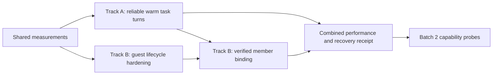

# Fleet execution performance — shared measurement and rollout contract

## 1. Objective and outcome

Improve response latency, validated task completion time and useful throughput across Codex, Claude Code
and Pi. Task execution and live-session participation are two linked solution sets. This contract is
their common measurement prerequisite, not a third independent metrics product.

These are proposals, not implementation or measured improvement claims. The operator requested solution
preparation; no automatic gate approval, source implementation, dependency upgrade or paid benchmark
execution is inferred. Each idea run retains the same verbatim operator request. Track-specific
interpretations live in the corresponding evaluation reports.

| Track | Idea run | Recommended approach |
| --- | --- | --- |
| A — existing task execution | 239ca033-d3f1-43b5-b6fa-02237dc489f3 | A2: measured scheduling improvements plus correlated persistent task turns |
| B — live-session participation | b0d3dc58-abc9-4525-b8a5-17f52dddbd63 | B2: reliable cooperative guests, followed by verified member binding |

## 2. KPI contract

Primary KPI: wall time from an eligible task's enqueue to its validated terminal success under the
same task scope, model/provider/reasoning settings, permissions and required quality gates.
Report p50/p95, successful tasks per hour, and completion rate together. Faster failed work is not a gain.

Record timestamps for eligible enqueue, claim, routing/preflight finish, process ready, turn accepted,
first meaningful agent output, first tool start, turn terminal, contract validation, gate completion
and final receipt. Use monotonic clocks for durations within one process; persist UTC timestamps and
correlation IDs for cross-process attribution. Do not compute invalid elapsed values across clock
domains. Mark unsupported or unobservable phases absent, not zero.

Distinguish:
- Queue time waiting on capacity/write ownership from scheduler or transport delay.
- First visible status from first useful agent output and from validated completion.
- Process reuse from conversation reuse and provider-side prompt caching.
- Agent work, model latency, tool work, gates, recovery and permission/operator wait.
- Task-level results from nested stage/attempt results; do not sum overlapping durations.

Proposed engineering targets below must be ratified after baseline collection. They are neither
promises nor current measurements.

| Metric | Candidate acceptance target | Comparison |
| --- | --- | --- |
| Warm task transport/preparation p95 | at least 40% lower | same agent and workload, cold/resume baseline |
| Validated end-to-end task duration | p50 at least 15% lower and p95 at least 10% lower | paired representative task suite |
| Useful throughput | at least 15% higher when independent work exists | same machine/resources and gates |
| Scheduling under orchestrator chat load | eligible enqueue-to-dispatch p95 at most 1 second | no capacity hold; deterministic E2E with a 30-second conversational turn |
| Attached-session delivery p95 | at most 1 second while ready and subscribed | exclude busy turns; report busy wait separately |
| Reliability and quality | no duplicate side effect or false success in failure suite; no completion-rate regression in paired samples | identical task assertions and gates |
| Token/cost and resources | report per successful task; investigate increases above 10% | same executor settings; include memory/CPU/idle processes |

If model/tool/gate time dominates, report A2's limited end-to-end effect and prioritize A3 rather than
declaring success solely from transport timings. No target permits weakened validation.

## 3. Repeatable evidence

Build the smallest E2E driver that reuses the existing fleet E2E setup. Two complementary lanes:

1. Deterministic protocol/process fixtures prove correctness, scheduler independence, cancellation,
   stale-result fencing, fragmented events, crash recovery and repeatable timing attribution.
   Fixtures cannot substantiate real model speed.
2. Opt-in real-agent paired trials compare cold, resume and persistent execution. Pin binary path,
   package/version, model/provider/reasoning, project revision, task fixture and tool settings.
   Alternate trial order; separate first-use cold startup, warm startup and growing-context trials.
   Do not claim to reset a provider cache unless the provider exposes and verifies that control.

Workloads: bounded response, read-only repository inspection, small isolated code edit with a
repeatable assertion, related remediation turn, independent fresh review, and mixed-role task chain.
Add live-join, busy-session delivery, leave and crash cases for B. Keep worktree ownership and
permissions identical. Record unavailable features and approvals required by a host.

Start with at least 30 paired transport samples per supported agent/mode; label p95 exploratory at
this size. Use at least 100 per cell for rollout-grade tail claims. Real coding tasks begin with
10 paired trials per workload/agent; report raw samples, variance and uncertainty, expanding only
when needed for a decision. These sample budgets are proposed future runs, not executed here.

A machine-readable receipt contains source revision, exact invocation/provenance, workload digest,
agent/mode/session/run/turn/attempt/occupant generation IDs, phase timings, outcome, assertion/gate
results, retries, token/cache usage when available, resource samples and redacted artifact paths.
Include all trials, failures, cancellations and timeouts; do not drop them from denominators or
treat a killed trial as a successful fast run. Report completion time conditional on success alongside
completion rate and time-to-failure. Emit JSON plus a short Markdown comparison with a repeat command.
Reuse existing run logs/trace IDs and redaction. Do not persist credentials or dump environments.

## 4. Delivery sequence and boundaries

1. Establish baseline and agent capability/version probes.
2. A1 scheduling fix and measurement first; this is independently useful.
3. A2 shared task-turn lifecycle and three transport integrations, one agent at a time.
4. B1 guest lifecycle reliability and portable pull behavior can be developed against the same receipt
   contract; B2 automatic stage participation waits for A2's completion and fencing semantics.
5. Run combined supervised/attached workloads before rollout.
6. Select A3 context/orchestration work only when the phase measurements justify it.
7. Batch 2: Grok Build and Antigravity CLI, with exact binary identity and support established first.

One writer per worktree remains mandatory. Read-only parallelism and isolated worktree execution
reuse existing controls; adding replicas alone cannot increase same-worktree write capacity.

No new public CLI noun/verb is proposed. Any changed public flags/DTOs or external ts-libs API
needs design review and the applicable operator consent before implementation. Reusable process
transports belong to ts-ai-runner; Spur owns scheduling, corpus, permissions, artifacts and receipts.
No external repository edit is authorized by these planning artifacts.

## 5. Evidence and open premises

Observed source, inspected 2026-10-21:
- `packages/app/src/services/agent-loop-service.ts:464`: keyed work bypasses persistent stdin.
- `packages/app/src/services/agent-loop-service.ts:587`: conversation is awaited before scheduling.
- `packages/app/src/services/system-event-follow.ts:31`: ledger follower cadence is 100 ms.
- `packages/app/src/services/write-slot-service.ts:68`: one write slot per worktree.
- `config/workflows/task-pipeline.yaml:231`: role doctor resolution already happens at precheck.
- `docs/reports/fleet-e2e-receipt.json:18`: existing fleet receipt uses agent stubs; this is correctness
  evidence, not a real-agent latency baseline.

Unverified: baseline latency distribution; fraction attributable to startup versus model/tools/gates;
cache hit behavior; memory costs of warm agents; host-version parity for interactive wake hooks.
Observed executable versions: Codex 0.163.0, Claude Code 2.1.306, PATH Pi 1.4.0. The installed runner
record cites older probes and the repository Pi dependency is 0.87.1; binary/package identity must
be recorded rather than assuming those installations are interchangeable.

## 6. Review status and next step

Both solution sets are discovery artifacts. Neither approach is approved or implemented.
Review A2 and B2 together, then continue the two idea runs through feature/AC/design/decomposition.
Metric thresholds can be adjusted at that review without weakening receipt or quality invariants.

